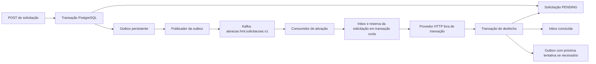

# Proposta: Kafka e deploy no home lab

Data: 30/10/2026. Status: diagnóstico e plano original. A arquitetura implementada está no [ADR 005](adr/005-kafka-outbox-inbox.md); a operação do ambiente está em [k8s/README.md](../k8s/README.md). As verificações abaixo representam o diagnóstico inicial, anterior à publicação.

## Diagnóstico confirmado

- A aplicação usa Java 21/Spring Boot 3.5.16, PostgreSQL e processamento assíncrono por polling com `FOR UPDATE SKIP LOCKED`. Ainda não depende de Kafka.
- `.github/workflows/verify.yaml` executa testes, constrói a imagem e analisa segredos/configuração. Não publica imagem nem faz deploy.
- O remoto `origin` aponta para `../desafio-ativacao.bundle`. A consulta dos repositórios da conta `ochannel-do` não encontrou este projeto no GitHub. Existe um commit local além do remoto; preservar o histórico.
- Acesso de leitura ao servidor `ochannel@192.168.1.80` validado. Para consultar o cluster como esse usuário: `KUBECONFIG=$HOME/.kube/config kubectl ...`. O kubeconfig padrão do K3s exige root.
- K3s com um nó amd64, `Ready`, versão `v1.36.4+k3s1`. Na consulta: aproximadamente 33% de CPU e 38% de memória utilizada; esses valores não substituem dimensionamento sob carga.
- Argo CD já instalado; aplicação `pedidobasecode-hml` em `Synced/Healthy`. O repositório `ochannel-do/pedidobasecode` já possui um pipeline Actions → GHCR → branch `deploy` → Argo CD.
- PostgreSQL disponível nos namespaces `databases-hml` e `databases-prod`. Reutilizar a instância de homologação com banco/usuário próprios, sem reutilizar as credenciais de outro serviço.
- Traefik e stack de observabilidade presentes: Alloy, Tempo, Loki, Prometheus e Grafana.
- Kafka ausente no cluster, confirmado também pelo usuário. Não foi encontrado serviço Kafka/Redpanda do sistema nem listener nas portas usuais do host.
- OpenBao inicializado, porém **selado**. External Secrets de homologação/produção em `SecretSyncedError`, com SecretStores inválidos. Restaurar essa integração antes de depender dela para novas credenciais. As chaves de unseal devem ser usadas pelo responsável no terminal privado, sem entrar no Git ou no chat.

## Arquitetura proposta



Manter um módulo e uma imagem inicialmente: API, publicador e consumidor na mesma aplicação. Kafka substitui o disparo de ativações pelo agendador; não exige separar imediatamente em microsserviços. Manter os contratos HTTP, a unicidade por `externalId` e o isolamento por `client_id`.

### Consistência e repetição

1. Gravar solicitação e evento de outbox na mesma transação. Requisição idêntica repetida não gera outro evento inicial.
2. Publicador reserva eventos com lease em transação curta, publica fora da transação e só registra a entrega após confirmação do Kafka. Lease vencido permite recuperação. Queda entre confirmação e gravação pode duplicar a mensagem: entrega pelo menos uma vez.
3. Mensagem com `eventId`, `schemaVersion`, `requestId`, `clientId`, versão/tentativa esperada e `correlationId`; chave Kafka igual a `requestId`. O banco mantém os dados usados para chamar o provedor. Validar formato e não confiar em dados de produto recebidos no evento.
4. Consumidor usa inbox persistente com unicidade por `(consumer_name, event_id)`; `consumer_name` identifica o consumidor lógico, não o pod nem o `client_id`. Em uma transação curta, registra/reserva a inbox e consulta/reserva a solicitação pelo id **e client_id**, validando versão, status e vencimento. Eventos antigos ou de estado final são registrados como descartados, sem acionar o provedor. Reserva confirmada antes do HTTP; desfecho em nova transação.
5. Preservar `Idempotency-Key = requestId` no provedor. A entrega do Kafka não garante exatamente uma chamada HTTP; a idempotência também depende do contrato do provedor.
6. Persistir desfecho da solicitação e conclusão da inbox na mesma transação; só depois confirmar o offset. Mensagem cuja inbox já está concluída/descartada pode ser confirmada sem repetir o HTTP. Falha de banco não pode confirmar a mensagem como concluída. A mera existência de uma linha na inbox não significa processamento concluído: reserva ainda em andamento exige aguardar ou recuperação durável, sem pular o trabalho.
7. Retentativa de negócio continua na política da aplicação: backoff, jitter, `Retry-After`, limite e `next_attempt_at`. Persistir novo evento com `available_at` no mesmo commit que devolve a solicitação a `PENDING` e conclui a inbox da tentativa atual; o publicador envia só quando vencer. Cada nova tentativa tem novo `eventId`; republicação do mesmo evento preserva o `eventId`. Não somar outro retry de negócio ao listener.
8. Reservas da inbox têm prazo e token de posse. Reconciliação de `PROCESSING` expirado encerra a reserva antiga e agenda novo evento de forma atômica com a alteração da solicitação. Worker antigo só pode concluir se a versão da solicitação e o token da reserva ainda forem válidos. Queda após HTTP e antes do commit pode repetir a chamada; manter a chave do provedor. Desativar o antigo processamento por lote no modo Kafka para evitar dois caminhos concorrentes.
9. Mensagens inválidas e erros técnicos recorrentes precisam de encaminhamento durável para `ativacao.hml.solicitacoes.v1.dlt`, alerta e procedimento de reenvio. `FAILED` de negócio continua registrado no banco e não deve ser confundido com erro de transporte.

Transações Kafka não tornam PostgreSQL e provedor HTTP uma única transação atômica. A outbox cobre a persistência/publicação; a inbox deduplica eventos e acompanha o processamento; a reserva e a chave do provedor cobrem concorrência e repetição da chamada externa. Definir retenção da inbox considerando a janela de replay dos tópicos e da DLT; apagar registros cedo demais permite reprocessar eventos antigos.

### Limites de dependência

- `core.domain`: regras de estado, Java puro.
- `core.application`: caso de uso por solicitação e portas necessárias para outbox, inbox, repositório e transação; sem tipos Kafka/Spring.
- `infrastructure.messaging`: serialização, produtor, listener, confirmação e tratamento de falhas técnicas.
- `infrastructure.persistence`: entidades JPA e migrações Flyway da outbox e inbox, mapeadas explicitamente.
- `infrastructure.config`: composição explícita; apenas portas decoradas expostas como beans.
- `infrastructure.scheduling`: publicação de eventos vencidos e reconciliação; chamada HTTP continua fora de transação.

## Kafka no K3s

Proposta inicial para laboratório: namespace `messaging`, um StatefulSet com um broker/controller Kafka em KRaft, sem ZooKeeper, PVC e serviço interno. Fixar versão/digest após conferir compatibilidade com o cliente gerenciado pelo Spring Boot 3.5. Não usar tag `latest`.

- Um broker implica fator de replicação 1, inclusive nos tópicos internos aplicáveis; não há alta disponibilidade. Três pods no mesmo host não resolveriam a falha do host.
- Definir retenção e limite em disco; medir consumo antes de fechar CPU, heap e memória. Preservar identidade do cluster e volume entre reinícios.
- Configurar listeners anunciados com endereço resolvível pelos pods. Inicialmente acessar administrativamente por port-forward; não publicar Kafka no ingress HTTP.
- Criar tópicos explicitamente, separados por ambiente, e identidade/ACL da aplicação. Configurar autenticação e transporte junto com o gerenciamento de segredos.
- Validar produção/consumo e persistência após reinício antes de ligar a aplicação. Planejar backup/recuperação conforme os dados que precisam sobreviver à perda do nó.

## GitHub Actions e entrega

Reaproveitar o padrão de `pedidobasecode`, adaptando para a branch `main` deste projeto e Java 21; não importar o GitFlow ou as versões Java/Spring daquele projeto.

```text
PR: formatação + ./mvnw verify + análise de segredos/configuração
main: mesmos checks → construir/analisar imagem → publicar no GHCR
      → atualizar digest no manifesto da branch deploy
Argo CD no home lab: observar deploy → sincronizar → verificar saúde
```

- Destino proposto: `ochannel-do/desafio-ativacao`; confirmar visibilidade antes de criar/publicar o repositório. Preservar o bundle como remoto de referência e os commits existentes.
- Imagem proposta: `ghcr.io/ochannel-do/desafio-ativacao`. Publicação pelo `GITHUB_TOKEN`, com `packages: write` só no job correspondente; permissões de escrita em Git só no job de manifesto.
- Publicar apenas a imagem que passou nos checks e na análise de vulnerabilidades. Usar digest imutável no Kustomize, serializar atualizações de ambiente e impedir que build antigo substitua versão recente.
- Primeiro ambiente: namespace `ativacao-hml`, Deployment, Service ClusterIP, ConfigMap, Secret via External Secrets, probes, limites e encerramento gracioso. Dimensionar inicialmente uma réplica; cluster tem um único nó.
- Argo CD com AppProject restrito ao repositório/namespace; acesso de leitura ao Git e credencial de pull do GHCR caso pacote privado. GitHub Actions não precisa de kubeconfig ou acesso direto à rede doméstica.
- Criar a branch `deploy` e publicar a primeira imagem válida antes de habilitar sincronização. Infraestrutura Kafka deve ter ciclo separado do release da aplicação.
- Banco próprio na instância `databases-hml`, credenciais no OpenBao, emissor/JWKS OAuth reais, endereço e credenciais do provedor. WireMock pode ser uma dependência explicitamente de homologação enquanto não houver provedor real.
- Integrar traces ao Alloy e coleta de métricas ao Prometheus. Alertas: idade da outbox, atraso do consumidor, DLT, erros do provedor e falha de sincronização do Argo CD.
- Validar readiness/rollout e uma ativação completa com token válido; publicação de imagem sozinha não equivale a deploy saudável. Rollback por reversão de digest; não desfaz migrações, que devem ser compatíveis.

## Sequência de implementação

1. Recuperar OpenBao/External Secrets; preparar banco, identidades e configuração de homologação. Operações do cofre ficam com o responsável pelas chaves.
2. Preparar e validar manifests do Kafka no laboratório.
3. Implementar outbox, inbox e consumo por solicitação com commits pequenos: primeiro `test:` demonstrando a falha esperada, depois `feat:`/`fix:`. Testes PostgreSQL + Kafka reais via Testcontainers, provedor via WireMock, ArchUnit preservado.
4. Cobrir queda do Kafka, republicação após crash, duplicação com inbox concluída e em andamento, evento antigo, disputa entre consumidores, HTTP sem transação, backoff/Retry-After, recuperação de PROCESSING/inbox, rejeição de worker com posse expirada e confirmação do offset após persistência. Verificar rollback conjunto de desfecho, inbox e próxima outbox.
5. Definir migração dos `PENDING` existentes para eventos sem perder nem duplicar tentativas; cortar o agendador antigo de forma coordenada. Não alternar os dois modelos sem procedimento de migração.
6. Executar `./mvnw spotless:apply` e `./mvnw verify`; atualizar ADR 003 e README de acordo com o comportamento implementado.
7. Preparar workflow e manifests de deploy; criar/publicar o repositório com visibilidade definida, configurar os acessos e cadastrar a Application no Argo CD.
8. Validar ponta a ponta no home lab, incluindo reinício, indisponibilidade do Kafka e recuperação. Registrar o resultado real do deploy.

## Referências

- [Modelo existente: pipeline do pedidobasecode](https://github.com/ochannel-do/pedidobasecode/blob/develop/.github/workflows/deploy.yaml)
- [Modelo existente: preparação do home lab](https://github.com/ochannel-do/pedidobasecode/blob/develop/k8s/README.md)
- [GitHub: publicação de imagens](https://docs.github.com/en/actions/tutorials/publish-packages/publish-docker-images)
- [Argo CD: integração com CI](https://argo-cd.readthedocs.io/en/stable/user-guide/ci_automation/)
- [Spring Kafka: sincronização e limites das transações](https://docs.spring.io/spring-kafka/reference/kafka/transactions.html)
- [Apache Kafka: papéis KRaft e limitações do modo combinado](https://kafka.apache.org/44/operations/kraft/)
